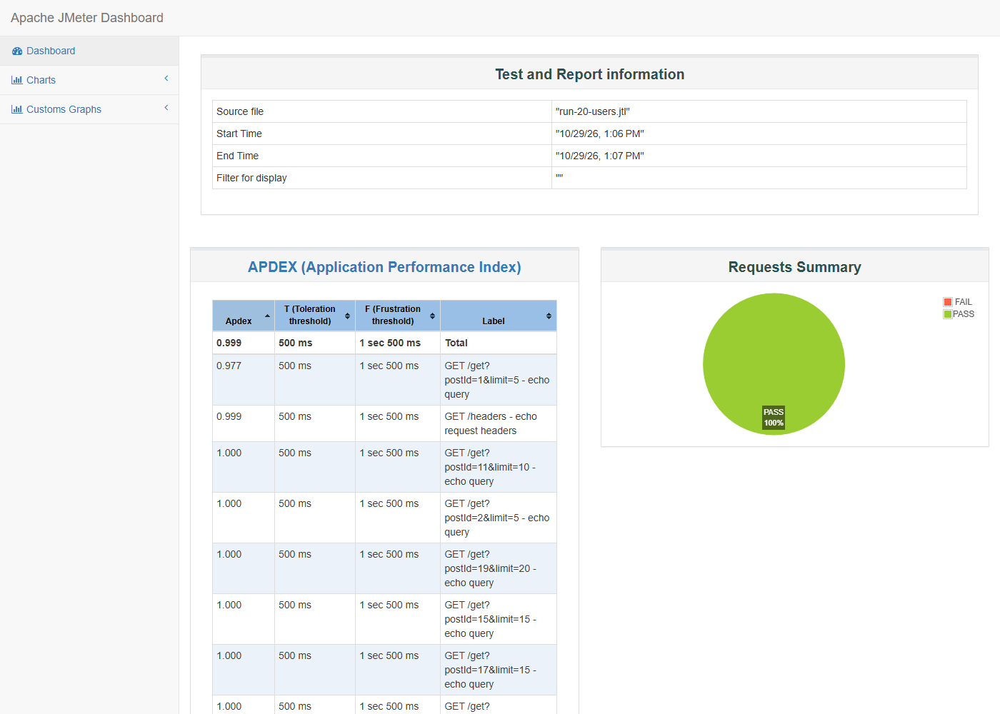
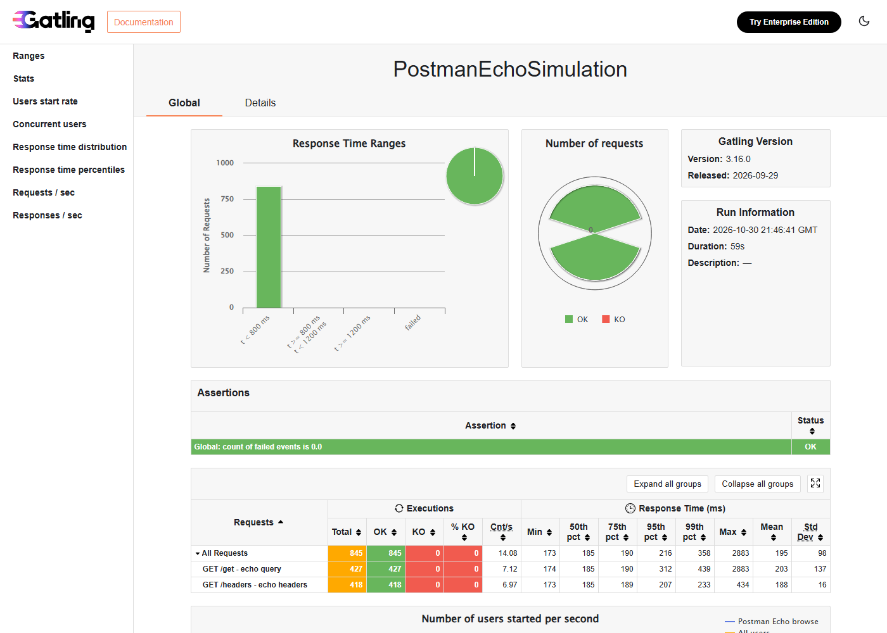

# ДЗ №4: нагрузочное тестирование REST API

**Стенд:** `https://postman-echo.com`. Стенд из ДЗ №2-3 не использован: `playground.nileslabs.com` ограничивает 60 запросов/мин на IP и на нагрузке отдаёт `429`. Нагрузка на demo-сервис: 5-20 VU, до ~14 req/s.

## Сценарий

Два read-only запроса:

| Запрос | Параметры | Проверки |
| --- | --- | --- |
| `GET /get` | query `postId`, `limit` | status 200; `$.args.postId`, `$.args.limit` |
| `GET /headers` | headers `X-Post-Id`, `X-Page-Size` | status 200; `$.headers.x-post-id`, `$.headers.x-page-size` |

Данные: `posts.csv` (20 строк, `postId`/`pageSize`, recycle). Think time: **1000 мс**. Профили: 5/10/20 VU, ramp-up 5/10/20 с, длительность 60 с.

## JMeter

Файлы: `load-test.jmx`, `posts.csv`, `results/run-*.jtl`, [HTML-отчёт (20 VU)](report/index.html).

| VU | Запросов | Throughput, req/s | Average, мс | Median, мс | p95, мс | Errors |
| --- | --- | --- | --- | --- | --- | --- |
| 5 | 230 | 3.9 | 241.8 | 202 | 528 | 0% |
| 10 | 462 | 7.9 | 185.1 | 177 | 205 | 0% |
| 20 | 837 | 14.2 | 187.9 | 180 | 216 | 0% |



## Gatling (бонус)

Модуль `gatling/`: Gatling 3.16.0, Java DSL, Maven, тот же endpoint, запросы, проверки, CSV и паузы. Профиль передаётся через `-Dusers/-Drampup/-Dduration`:

```bash
cd load-tests/gatling
mvn gatling:test -Dusers=20 -Drampup=20 -Dduration=60
```

Или все три профиля: `.\run-gatling.ps1` / `./run-gatling.sh`.

Исходник: [`PostmanEchoSimulation.java`](gatling/src/test/java/ru/mts/itmo/aqa/load/PostmanEchoSimulation.java).

| VU | Запросов | Throughput, req/s | Average, мс | Median, мс | p95, мс | Errors |
| --- | --- | --- | --- | --- | --- | --- |
| 5 | 242 | 4.03 | 198 | 186 | 237 | 0% |
| 10 | 457 | 7.62 | 212 | 187 | 243 | 0% |
| 20 | 845 | 14.08 | 195 | 185 | 216 | 0% |

[HTML-отчёт Gatling (20 VU)](gatling/report/index.html)



### Сравнение

- **Профиль и проверки совпадают.** Throughput практически одинаков: 3.9/7.9/14.2 против 4.03/7.62/14.08 req/s; на 10/20 VU p95 205/216 мс у JMeter и 243/216 мс у Gatling; ошибок нет.
- **Подход.** JMeter: XML-план, GUI/CLI, CSV Data Set, Constant Timer, Response Assertion. Gatling: код на Java DSL, Maven-модуль, feeder, `pause`, checks; сценарий компактнее и удобнее для code review, но требует JDK/Maven.
- **5 VU.** У JMeter p95 528 мс из-за холодного старта; у Gatling 237 мс. На 10 VU у Gatling среднее 212 мс из-за двух выбросов до 3.6 с, p95 при этом 243 мс.

## Вывод

В диапазоне 5-20 VU (до ~14 req/s) API стабилен: Throughput растёт почти линейно, p95 не превышает 243 мс, Error Rate 0%. Момент деградации не достигнут; для его поиска нужен больший уровень нагрузки или локальный стенд.

## Воспроизведение

- JMeter: `.\load-tests\run-load-test.ps1` или `./load-tests/run-load-test.sh`.
- Gatling: `cd load-tests/gatling && mvn gatling:test ...`; скрипты `run-gatling.ps1` / `run-gatling.sh`.
- Абсолютные значения зависят от сети и demo-сервиса; ожидаемое поведение - линейный рост Throughput и отсутствие ошибок.
